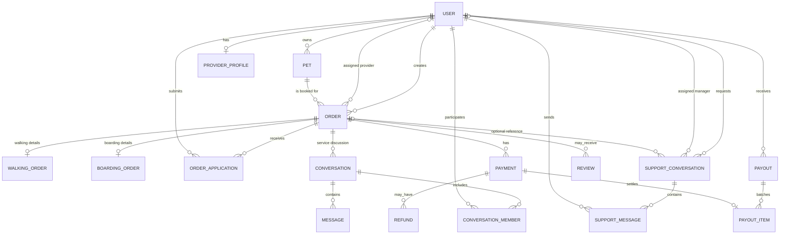

# Domain data model

**Status:** target model for discussion. “Current” means present in the API code/schema; “planned” means a boundary to agree before implementation.

## Relationships

The diagram shows the intended domain, not a promise that every table exists today. A payout may group several settled payments. Final payment cardinalities and states depend on marketplace rules and the selected provider.

## Entities by domain

| Domain | Current | Target additions |
| --- | --- | --- |
| Identity | `User` | Revocable `Session`, email/phone `Verification`, recovery records, staff permissions, one-to-one `ProviderProfile` and verification state |
| Pet care | `Pet` | Private vaccine/identity document metadata only if product policy requires it |
| Marketplace | `Order`, `WalkingOrder`, `BoardingOrder`, `OrderApplication` | Provider services, service area, availability, cancellation/dispute history |
| Conversations | `SupportConversation`, `SupportMessage` | Order-linked owner/provider `Conversation`, `ConversationMember`, `Message`, read state, staff audit events |
| Payments | Price and preliminary payment fields on `Order` | Separate `Payment`, `Refund`, `Payout`, `PayoutItem`, and provider webhook/event records |
| Trust | Ratings are currently fields on `User` | Per-order `Review`, moderation/report events, verification state |
| Notifications | None | `Notification` and delivery attempts, separate from source order/message state |

## Lifecycle rules

### Account and provider profile

One `User` identity may have owner and provider capabilities. The active workspace is a client navigation preference; every API action is checked against server-side capabilities. Keep provider verification/approval in a separate `ProviderProfile` state so choosing the provider workspace never bypasses onboarding requirements.

### Order

Current API statuses are `pending → accepted → in_progress → completed`, with `cancelled` and `disputed` states also present. Before expanding them, define allowed transitions, who can trigger each transition, cancellation windows, dispute handling, and what happens to related payments.

### Application

Current application states are `pending`, `accepted`, and `rejected`. Only the order owner can choose an applicant; the server must atomically ensure that only one provider is assigned.

### Support conversation

Current states are `open`, `waiting`, and `resolved`. A customer reply opens the conversation; a staff reply marks it as waiting for the customer. Support messages are separate from order service conversations.

### Payment

Keep payment status separate from order status. A future payment can have multiple attempts, refunds, and a settlement/payout record. Exact states depend on provider capabilities and the agreed charge, refund, and payout rules.

## Data protection rules

- Store internal numeric IDs for relations; expose public IDs where enumeration resistance is needed.
- Avoid copying full addresses or pet medical information into chat messages and notifications.
- Return only an approximate location before provider assignment; never rely on frontend masking.
- Keep provider transaction references and event IDs, not raw card data.
- Define retention and deletion behavior for account removal, support conversations, disputes, and payment records before launch.
