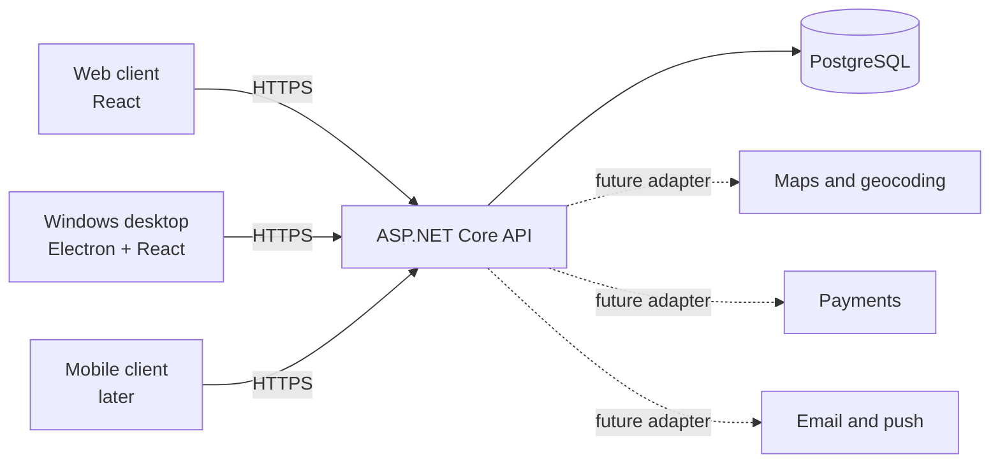

# Product and application architecture

**Status:** product baseline. See [system architecture](SYSTEM_ARCHITECTURE.md), [screen map](SCREEN_MAP.md), [data model](DATA_MODEL.md), and [open decisions](DECISIONS.md). Mobile follows on the same API.

## Product surfaces

- **Web:** public information pages and the owner/sitter workspace in a browser.
- **Windows desktop:** the same React workspace inside a hardened Electron shell.
- **Mobile:** a later client with the same account, order, and support services.
- **API:** ASP.NET Core modular monolith. It owns authentication, permissions, business rules, and persistence.
- **Database:** PostgreSQL. Client applications never connect to it directly.



## Account roles

- **Owner:** maintains dog profiles and creates walking or boarding orders.
- **Sitter:** sets services and availability, finds orders, applies, and completes assigned work.
- **Both:** uses one account to switch between owner and provider workspaces; provider actions still depend on provider profile state.
- **Support manager:** an internal staff permission, assigned by an administrator. Public registration cannot grant staff access.

## Main flows

1. An owner registers, adds a dog, describes a service, time, approximate location, and care instructions, then publishes an order.
2. A sitter filters available orders, opens the details, and applies.
3. The owner reviews applications and assigns one sitter. The exact address is revealed only to the owner and assigned sitter.
4. The sitter starts and completes the service and submits a short report.
5. Either account can open **Support** and contact a manager. A support conversation can be linked only to an order that account owns or is assigned to.

Order status and payment status remain separate. Payments, live map tracking, real geocoding, provider profiles/verification, and customer-to-sitter messaging are later integrations or milestones; they must not be shown as working until implemented.

## Manager support chat

Support chat is a first-class workspace for both owners and sitters on web and desktop, and later on mobile through the same API.

- A signed-in user can start a private conversation, choose a topic, and optionally attach an order reference.
- The conversation has a queue/assignment state and an open, waiting, or resolved status.
- Only the requester and authorized support staff can read or write messages. The API checks this for every request.
- Staff permissions are internal and user-supplied registration fields never grant support access. Assignment and status changes are not yet written to a dedicated audit log.
- The current version supports text and timestamps with polling. File attachments and read receipts need storage/access rules and retention before implementation.
- Keep support conversations separate from service conversations between an owner and a sitter.

## Repository boundaries

The backend and frontend remain separate repositories so their builds and releases are clear. Product architecture and screen documentation live in the frontend repository under `docs/architecture/`; API setup and server-specific design live in the backend repository under `docs/`.

### Frontend repository

```text
src/
  api/                 API client and authentication context
  pages/               Login and role workspaces
  assets/              Bundled images and icons
desktop/
  electron/            Main process and desktop protocol
  scripts/             Local desktop development launcher
docs/
  architecture/        Product architecture and screen map
  development/         Windows desktop build instructions
public/                Static web assets
```

`dist/` and `release/` are generated build output and are not source files.

### API repository

```text
Controllers/           HTTP endpoints and authorization
Dtos/                  Request/response contracts
Models/                Persistent domain entities
Data/                  EF Core context and design-time factory
Migrations/             PostgreSQL schema history
Services/               Authentication and shared application services
infra/local/            Local-only PostgreSQL Compose setup
docs/architecture/      API boundaries and security model
docs/development/       Local setup and migration steps
```

## Security boundaries

- The desktop renderer loads bundled local assets through the `dogwalking://app` protocol. It has no Node.js integration or general Electron API bridge.
- Electron navigation is limited to the app origin; new windows are denied by default.
- The API enforces roles, resource ownership, and address visibility. Hiding a button in React is not an access control.
- Use HTTPS for deployed API traffic. Keep signing keys, database credentials, and payment credentials in server-side secret storage.
- The app stores only the session data required by the current authentication flow; refresh-token rotation and revocable sessions are follow-up security work.

## Deliberately pending decisions

- Launch country/city and the production map/geocoding provider.
- Hosting domain for the API and web client.
- Payment provider, fees, refunds, and payout rules.
- Email verification and password recovery workflow.
- Support staffing hours, response targets, and conversation retention.
- Provider verification requirements and account recovery policy.
