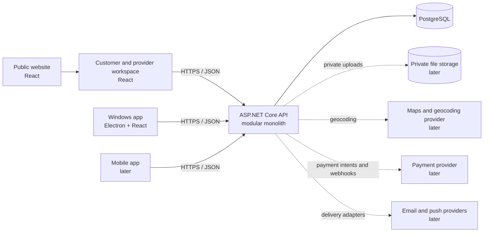

# System architecture

**Status:** draft baseline for review. This document describes the intended product and boundaries. It does not mean that every planned module already exists in code.

## 1. Product surfaces and release order

1. **Windows desktop:** first packaged application for owners and service providers. It uses the shared web workspace.
2. **Website:** public information pages plus the same authenticated workspace in a browser. The website and desktop client do not contain separate business rules.
3. **Mobile application:** a later client that uses the same API and account model.
4. **Staff workspace:** a protected internal workspace for support and, later, operations staff.

## 2. Component view



The API is the only component allowed to access PostgreSQL or provider secrets. Start with a **modular monolith**, not microservices: one API deployment and database, with clear domain boundaries inside the codebase.

## 3. Backend domain modules

| Module | Responsibility | Main data |
| --- | --- | --- |
| Identity and access | Registration, login, sessions, roles, recovery, verification | User, Session, Verification |
| Profiles and pets | Owner profile, provider profile, pet care details | User, ProviderProfile, Pet |
| Services and availability | Walking/boarding capabilities, areas, schedules | ServiceOffering, Availability |
| Marketplace and orders | Search, order creation, applications, assignment, service lifecycle | Order, WalkingOrder, BoardingOrder, OrderApplication |
| Conversations | Owner-provider communication linked to an accepted order | Conversation, Message |
| Support | Private request-to-manager conversation and staff queue | SupportConversation, SupportMessage |
| Payments and payouts | Charges, refunds, provider settlement, reconciliation | Payment, Refund, Payout |
| Reviews and trust | Completed-service reviews, reports, verification state | Review, TrustEvent |
| Notifications | In-app events and external delivery | Notification, DeliveryAttempt |
| Operations | Staff access, audit history, moderation and support administration | StaffPermission, AuditEvent |

Each module owns its validation and use cases. Controllers translate HTTP requests into those use cases; DTOs define the public API contract. A module must not return EF entities directly.

## 4. Client boundaries

- React owns navigation and presentation. It can hide unavailable actions for clarity, but it never authorizes access.
- Electron packages the same renderer and keeps Node.js APIs out of the renderer. Desktop-only code stays under `desktop/electron/`.
- A future mobile client reuses API contracts and business rules; it does not connect to the database.
- The public site and authenticated workspace may share frontend build assets, but public pages do not receive authenticated customer data.

## 5. Trust and security boundaries

- All deployed API traffic uses HTTPS. API authorization derives user identity and role from a validated server-issued token.
- Public registration can create only customer/provider roles. Support and operations permissions require a controlled staff provisioning process.
- The server checks ownership for every pet, order, message, address, and payment request.
- Search and map results show approximate location. The exact address is visible only to the owner and the assigned provider.
- Payment card details stay with the payment provider. Store provider references and transaction state, not card numbers or security codes.
- Payment webhooks must verify provider signatures and process event IDs idempotently.
- Private documents or message attachments require private storage, explicit access checks, file type/size limits, retention rules, and malware scanning before release.
- Staff actions that access customer data should produce an audit record.

## 6. Source organization target

Keep the API and frontend as separate repositories. Organize future additions by feature and keep infrastructure/shared code explicit. The current implementation is small; refactor folders only after the boundaries are approved.

### Frontend

```text
src/
  app/                 Router, auth guards, shared application layouts
  features/
    auth/
    pets/
    orders/
    conversations/
    support/
    profile/
    payments/          future
  shared/
    api/               API client and common request handling
    components/
    hooks/
    styles/
  pages/               Route-level composition
desktop/
  electron/            Main process and dogwalking:// protocol
  scripts/
docs/
  architecture/
  development/
```

### API

```text
Controllers/            Thin HTTP endpoints
Features/
  Identity/
  Profiles/
  Pets/
  Services/
  Orders/
  Conversations/
  Support/
  Payments/             future
  Reviews/              future
  Notifications/        future
Infrastructure/
  Persistence/          EF Core context and configurations
  Security/
  Integrations/          Maps, payments, email providers
Migrations/
docs/
infra/local/
```

This is a target layout, not a requirement to move the existing files now. Preserve the current build and database migration history while any refactor is done.

## 7. Build sequence

1. Confirm the decisions in [DECISIONS.md](DECISIONS.md).
2. Approve role-specific navigation and the public website scope in [SCREEN_MAP.md](SCREEN_MAP.md).
3. Approve the domain entities and status lifecycles in [DATA_MODEL.md](DATA_MODEL.md).
4. Agree API contracts and security rules before adding more screens.
5. Implement one end-to-end vertical flow at a time: secure account → pet/profile → service request → provider application/assignment → service completion.
6. Add production map and payment providers after launch market and operational rules are decided.
7. Harden the Windows release; plan the mobile client only after shared API contracts stabilize.

## 8. Current versus planned

Current code includes sign-in/registration, owner and provider order flows, pet profiles, the Windows Electron shell, and text-based support chat. Real geocoding, provider/customer service chat, email/phone verification, production session management, payment processing, payouts, public marketing pages, and a full staff administration console remain future work.
